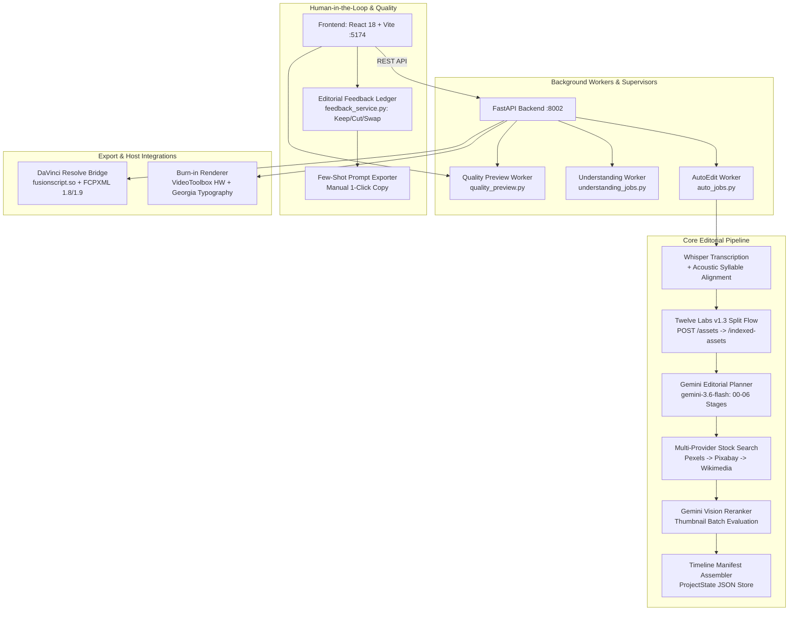

# DaVinci Resolve AI Editing Companion Skill

The **DaVinci Resolve AI Editing Companion** is an intelligent assistant and automation workstation for video editors. It integrates multi-language audio transcription (Whisper), acoustic syllable peak alignment, automated Hindi/Hinglish-to-English translation, Twelve Labs v1.3 multimodal semantic video understanding, Gemini structured editorial planning, contextual multi-provider stock acquisition with vision reranking, non-destructive documentary quality preview benchmarks, human editorial feedback ledgering, and hardware-accelerated VideoToolbox burn-in rendering alongside deep DaVinci Resolve Python/Fusion timeline integration.

---

## Quick Reference & Ports

| Component | Technology | Default Port / Command / Path |
| :--- | :--- | :--- |
| **Frontend UI** | React 18, TypeScript, Vite, Tailwind CSS | Port `5174` (`npm run dev` in `frontend/`) |
| **Backend API** | FastAPI, Uvicorn, Python 3.10+ | Port `8002` (`python3 -m uvicorn app.main:app --host 0.0.0.0 --port 8002 --reload`) |
| **Unified Launcher**| Bash script | `./start_companion.sh` |
| **Database** | SQLite + SQLAlchemy | `backend/resolve_companion.db` |
| **Projects Store** | JSON manifests & media caches | `backend/projects/<project_id>/` |
| **Active Project** | `new_1790101050` (`111sub`) | 88s medical/documentary timeline (76 captions, 39 graphics) |
| **Quality Benchmark** | 30s versioned preview (`quality_preview.py`) | `backend/projects/<project_id>/quality/<revision>/preview.mp4` |
| **Asset Cache** | Full-file SHA-256 fingerprint store | `backend/projects/twelve_labs_assets.json` |
| **Feedback Ledger** | Keep / Cut / Swap human overrides | `backend/projects/editorial_feedback.json` |
| **FFmpeg Binary** | Hardware VideoToolbox / imageio-ffmpeg | macOS native `/opt/homebrew/bin/ffmpeg` or vendored runtime |

> [!IMPORTANT]
> **macOS Sandbox Isolation Note**: When starting the backend server or running scripts that make external network calls (Twelve Labs, Gemini, Pexels, Pixabay) or DNS queries, commands must run with `BypassSandbox: true` to prevent `[Errno 8] nodename nor servname provided, or not known`.

---

## System Architecture



---

## REST API Reference

### 1. Project Management (`/api/projects`)

* **`GET /api/projects`**: List all existing projects with media metadata, durations, and caption counts.
* **`POST /api/projects`**: Create a new project workspace.
  * *Request Body*: `{"name": string, "aspect_ratio": "9:16" | "16:9"}`
* **`GET /api/projects/{project_id}`**: Retrieve project manifest, timeline cues, captions, and settings.
* **`PUT /api/projects/{project_id}`**: Update project manifest.
* **`POST /api/projects/{project_id}/autosave`**: Autosave project state. Rejected if stale revision or if a server-owned auto-job is running.
* **`POST /api/projects/{project_id}/rename`**: Rename project.
* **`POST /api/projects/{project_id}/relink`**: Relink media source path.
* **`DELETE /api/projects/{project_id}`**: Safely moves project directory to `~/.Trash` via macOS `/usr/bin/trash` and removes DB records.
* **`POST /api/projects/{project_id}/quality-preview`**:
  * Triggers background 30-second versioned documentary style benchmark render (`quality_preview.py`).
  * *Response*: `{"status": "rendering"|"complete", "revision": "<sha256:16>", "percent": int}`
* **`GET /api/projects/{project_id}/quality-preview`**: Poll quality preview status.
* **`GET /api/projects/{project_id}/quality-preview/{revision}/video`**: Stream rendered 30-second benchmark MP4.

---

### 2. Subtitles & Audio Transcription (`/api/subtitles`)

* **`POST /api/subtitles/transcribe`**:
  * Runs Whisper model on project audio with optional translation.
  * *Parameters*: `{"project_id": string, "language": "hi"|"en"|null, "task": "translate"|"transcribe", "model_size": "small"|"base"|"medium"}`
* **`POST /api/subtitles/translate`**: Translates Hindi/Hinglish transcripts to medical-grade English via Gemini.
* **`POST /api/subtitles/split`** & **`POST /api/subtitles/merge`**: Manually split or merge subtitle blocks with syllable re-interpolation.
* **`POST /api/subtitles/detect-keywords`**: Scans transcript for medical conditions, anatomical organs, emotional triggers, and metrics.
* **`POST /api/subtitles/detect-dimensions-and-cues`**:
  * Scans transcript for visual triggers, numerical dimensions, and narrative shifts.
  * Generates 50/50 vertical split cues, stock queries, and visual reasoning logs.
* **`GET /api/subtitles/{project_id}/visual-reasoning-log`**: Retrieves structured decision chain for each cue.
* **`PUT /api/subtitles/{project_id}/captions`**: Update captions and word-level karaoke timestamps manually.

---

### 3. Media & Upload Pipeline (`/api/media`)

* **`POST /api/media/{project_id}/upload`**:
  * Native XHR binary streaming upload with `X-Filename: <encoded>` header. Zero RAM overhead, atomic swap.
* **`POST /api/media/{project_id}/auto-produce`**:
  * Starts server-owned asynchronous automatic editing job (`auto_jobs.py`).
  * Runs Whisper $\rightarrow$ Twelve Labs $\rightarrow$ Gemini Editorial Planner $\rightarrow$ Vision Reranker $\rightarrow$ Asset Downloader $\rightarrow$ Timeline assembly.
* **`GET /api/media/{project_id}/auto-produce/status`**:
  * Returns live stage: `transcription_and_translation`, `video_understanding`, `editorial_planning`, `stock_search`, `asset_download`, `complete`, `interrupted`, or `failed`.
* **`GET /api/media/{project_id}/editorial-report`**:
  * Returns structured report and inspectable stage outputs (`00_transcript` through `06_timeline`).
* **`POST /api/media/{project_id}/upload-asset`**: Upload custom B-roll, document, or overlay asset.
* **`GET /api/media/{project_id}/asset/{filename}`**: Serve project custom asset.
* **`GET /api/media/{project_id}/proxy`**: Stream 720p hardware proxy video.
* **`GET /api/media/{project_id}/source-video`**: Stream source video with HTTP range requests (`206 Partial Content`).
* **`POST /api/media/{project_id}/render-burnin`**:
  * Renders burned-in MP4 using Apple Silicon VideoToolbox (`h264_videotoolbox`) with software `libx264` fallback.
* **`GET /api/media/{project_id}/render-progress`**: Polling endpoint returning render percentage and frame count.
* **`GET /api/media/{project_id}/download-mp4`**: Download exported finalized MP4.

---

### 4. Twelve Labs Video Understanding (`/api/media/twelve-labs` & `/understanding-review`)

* **`GET /api/media/twelve-labs/credits`**:
  * Live credit meter: returns total allowance (600.0 mins / 10 hours), consumed minutes, remaining minutes, remaining 1-minute videos, and expiry date (2026-12-20).
* **`POST /api/media/twelve-labs/set-key`**: Verify and persist Twelve Labs API key to `backend/.env`.
* **`POST /api/media/{project_id}/twelve-labs/analyze`**:
  * Direct split upload via `POST /assets`, indexes into `Resolve-Companion-Index`, and performs non-streaming Pegasus 1.5 analysis.
* **`GET /api/media/twelve-labs/tasks/{task_id}`**: Polls asset or index task status.
* **`POST /api/media/{project_id}/understanding-review`**:
  * Triggers read-only semantic analysis without modifying project timeline or downloading assets (`understanding_jobs.py`).
* **`GET /api/media/{project_id}/understanding-review`**:
  * Returns latest understanding report, segments, entities, claims, visible context, and uncertainties.

---

### 5. Multi-Provider Stock Search & Vision Reranker (`/api/media`)

* **`GET /api/media/search`**:
  * Queries media providers strictly adhering to priority:
    1. **Pexels** (Curated video/photo)
    2. **Pixabay** (Secondary licensed stock)
    3. **Wikimedia Commons** (Strict fallback only)
  * *Query Params*: `query=string&type=all|image|video&provider=all|pexels|pixabay|wikimedia`
* **Gemini Vision Reranker**:
  * Implemented in `media_search_service.py` (`rerank_candidates_with_vision`).
  * Batches top 8–10 candidate thumbnails to Gemini Vision with editorial reasoning context.
  * Selects the optimal match with justification or rejects candidates if unsuitable.
  * Strict 6.0s timeout with automatic fallback to Candidate #1.

---

### 6. Editorial Feedback & Training Ledger (`/api/feedback`)

* **`POST /api/feedback/decisions`**:
  * Records human editor overrides (`keep`, `cut`, `swap`) with timecodes, search query, reasoning, and optional replacement details.
  * Stored in `backend/projects/editorial_feedback.json` and project-level directories.
* **`GET /api/feedback/decisions`**:
  * Query logged editorial decisions filtered by `project_id`, `decision`, or `graphic_type`.
* **`GET /api/feedback/stats`**:
  * Returns aggregate decision counts, keep rate, cut rate, swap rate, and summary text (e.g. `124 decisions → 71 kept | 31 cut | 22 modified`).
* **`GET /api/feedback/few-shot-export`**:
  * Exports formatted few-shot training examples (Positive Keep vs Negative Cut) in markdown for 1-click prompt copying.

---

### 7. Motion Graphics & Dynamic Articles (`/api/graphics` & `/api/articles`)

* **`GET /api/graphics/templates`**: List all 18 pre-built motion graphic templates (split screen, clinical callout, kinetic typography, article reconstruction, etc.).
* **`GET /api/graphics/dynamic-samples/{project_id}`**: Returns project-specific generated graphic samples.
* **`POST /api/graphics/analyze-beats/{project_id}`**: Detects speech pacing and visual cut beats.
* **`POST /api/articles/parse`**: Scrapes URL or raw text into headline, author, publication, date, body, and key findings.
* **`GET /api/articles/presets`**: Returns clinical and news publication presets (The Lancet, NEJM, Nature, BBC, etc.).

---

### 8. DaVinci Resolve Native Bridge (`/api/davinci`)

* **`GET /api/davinci/status`**: Tests IPC connection to running DaVinci Resolve instance via `fusionscript.so`.
* **`POST /api/davinci/sync`**: Directly injects cut points, subtitle tracks, and Fusion templates into active Resolve timeline.
* **`POST /api/davinci/{project_id}/export-bundle`**: Generates Apple FCPXML 1.8/1.9 timeline file and media bundle.
* **`GET /api/davinci/{project_id}/download-bundle`**: Download exported timeline bundle.
* **`POST /api/davinci/{project_id}/open-in-resolve`**: Programmatically opens project inside DaVinci Resolve.
* **`POST /api/davinci/{project_id}/open-in-finder`**: Reveals project assets in macOS Finder.

---

## Operating Runbooks

### Runbook 1: Starting the Workstation & Environment

1. **Backend Server (FastAPI on Port 8002)**:
   ```bash
   cd /Users/sushil/.gemini/antigravity/scratch/davinci-companion/backend
   python3 -m uvicorn app.main:app --host 0.0.0.0 --port 8002 --reload
   ```
2. **Frontend UI (Vite on Port 5174)**:
   ```bash
   cd /Users/sushil/.gemini/antigravity/scratch/davinci-companion/frontend
   npm run dev
   ```
3. **Or launch both via the startup script**:
   ```bash
   ./start_companion.sh
   ```
4. **Building Frontend for Production**:
   ```bash
   cd /Users/sushil/.gemini/antigravity/scratch/davinci-companion/frontend
   npm run build -- --configLoader native
   ```

---

### Runbook 2: Running the End-to-End Automatic Editing Pipeline

1. In the web interface, open the **Project Drawer** and upload a video, or send via API:
   ```bash
   curl -X POST "http://localhost:8002/api/media/proj_111sub/auto-produce" \
        -H "Content-Type: application/json" \
        -d '{"force": false, "model_size": "small"}'
   ```
2. Poll execution status:
   ```bash
   curl "http://localhost:8002/api/media/proj_111sub/auto-produce/status"
   ```
3. The server runs through the stages:
   * **Stage 1**: Whisper speech-to-text with syllable peak alignment and Hinglish $\rightarrow$ English translation.
   * **Stage 2**: Twelve Labs v1.3 split upload (`POST /assets`), indexed-asset creation, and Pegasus 1.5 semantic observation.
   * **Stage 3**: Gemini structured editorial planning (`gemini-3.6-flash`), saving stages `00_transcript.json` to `06_timeline.json`.
   * **Stage 4**: Multi-provider stock search with Gemini Vision Reranking.
   * **Stage 5**: Parallel asset download to `backend/projects/<id>/media/downloaded/`.
   * **Stage 6**: Timeline manifest update and recovery checkpointing.

---

### Runbook 3: Inspecting Editorial Decisions & Semantic Understanding

1. In the web UI, click **Review automatic edit** in the top navigation bar or Left Sidebar.
2. The **Editorial Plan Panel** (`EditorialPlanPanel.tsx`) opens:
   * Inspect the complete stage chain: Transcript $\rightarrow$ Understanding $\rightarrow$ Editorial Decisions $\rightarrow$ Schedule $\rightarrow$ Asset Review $\rightarrow$ Placement $\rightarrow$ Final Timeline.
   * Review human-readable rationales explaining why each B-roll cutaway, split layout, or typography punch was selected.
3. Click **Analyze understanding** to launch a read-only analysis without altering the project:
   ```bash
   curl -X POST "http://localhost:8002/api/media/new_1790101050/understanding-review"
   curl "http://localhost:8002/api/media/new_1790101050/understanding-review"
   ```

---

### Runbook 4: Generating and Verifying 30-Second Quality Previews

1. To generate a 30-second documentary style preview without touching the active project timeline:
   ```bash
   curl -X POST "http://localhost:8002/api/projects/new_1790101050/quality-preview"
   ```
2. Poll status until complete:
   ```bash
   curl "http://localhost:8002/api/projects/new_1790101050/quality-preview"
   ```
3. Inspect the rendered benchmark:
   * Path: `backend/projects/new_1790101050/quality/<revision>/preview.mp4`
   * Scene Plan: `backend/projects/new_1790101050/quality/<revision>/scene-plan.json`
4. Verify key quality metrics:
   * Grammar-weighted phrase captions with stable typography (no single-word flickering).
   * Eased camera pushes on sentence starts (`sin(pi * u)**2`).
   * Split-screen illustrative footage with "ILLUSTRATIVE FOOTAGE" banner below presenter.
   * Distinct ivory/teal "KEY CONCEPT" cards for 2–5 word core concepts.

---

### Runbook 5: Sourcing Stock Media & Running the Gemini Vision Reranker

1. Query stock candidates:
   ```bash
   curl "http://localhost:8002/api/media/search?query=cancer+cells+microscope&type=video&provider=all"
   ```
2. Behind the scenes, `media_search_service.py`:
   * Queries Pexels, Pixabay, and Wikimedia Commons.
   * Pre-fetches candidate thumbnails in parallel using a thread pool.
   * Sends thumbnails and visual reasoning to Gemini Vision.
   * Returns the selected candidate with justification or falls back to Candidate #1 within 6.0 seconds.

---

### Runbook 6: Human Editorial Feedback, Decision Ledger & Few-Shot Prompt Export

1. Open the **Editorial Feedback Modal** (`EditorialFeedbackModal.tsx`) from the sidebar.
2. For any AI-suggested graphic cue, log a judgment:
   * **Keep**: High visual relevance; approve for final render.
   * **Cut**: Cluttered, unnecessary, or semantically incorrect.
   * **Swap**: Re-route to a different template or refined search query.
3. Review aggregate statistics:
   ```bash
   curl "http://localhost:8002/api/feedback/stats"
   ```
4. Export few-shot prompt markdown for model refinement:
   ```bash
   curl "http://localhost:8002/api/feedback/few-shot-export"
   ```
5. Click **Copy Prompt** in the modal to manually paste curated examples into future prompts.

---

### Runbook 7: Hardware-Accelerated VideoToolbox Burn-in Rendering & DaVinci Resolve Sync

1. Trigger hardware burn-in render:
   ```bash
   curl -X POST "http://localhost:8002/api/media/new_1790101050/render-burnin" \
        -H "Content-Type: application/json" \
        -d '{"subtitles_only": false, "use_hardware_accel": true}'
   ```
2. Poll progress:
   ```bash
   curl "http://localhost:8002/api/media/new_1790101050/render-progress"
   ```
3. Verify frame rendering:
   ```bash
   ffmpeg -ss 00:00:10.000 -i "backend/projects/new_1790101050/exports/full_burned.mp4" -vframes 1 -q:v 2 "test_frame.png"
   ```
4. Push timeline directly into DaVinci Resolve Studio:
   ```bash
   curl -X POST "http://localhost:8002/api/davinci/sync" \
        -H "Content-Type: application/json" \
        -d '{"project_id": "new_1790101050"}'
   ```
   Or export Apple FCPXML:
   ```bash
   curl -X POST "http://localhost:8002/api/davinci/new_1790101050/export-bundle"
   ```

---

## Troubleshooting & FAQ

### Issue 1: `[Errno 8] nodename nor servname provided, or not known`
* **Cause**: macOS terminal sandbox isolating sockets and blocking DNS queries to Twelve Labs, Google AI, Pexels, or Pixabay.
* **Fix**: Ensure the backend server and scripts making external network calls run outside the sandbox (`BypassSandbox: true`).

### Issue 2: Twelve Labs Index Returns `409 Conflict` or Long Indexing Times
* **Cause**: Asset already exists or indexer is operating asynchronously.
* **Fix**: The service automatically handles HTTP 202 Accepted and HTTP 409 Conflict, treating existing indexed assets as valid. The polling loop in `wait_for_indexed_asset_ready` checks status every 5 seconds up to 360 seconds.

### Issue 3: Google GenAI Model `gemini-2.5-flash` Returns HTTP 404
* **Cause**: Newer Google AI API accounts deprecate or do not support `gemini-2.5-flash`.
* **Fix**: Configure `EDITORIAL_MODEL="gemini-3.6-flash"` in `backend/.env`. The backend automatically routes structured planning and vision review through this model.

### Issue 4: `Vite config loader failed` during `npm run build`
* **Cause**: `node_modules` is a symlink outside the project workspace, causing Vite's esbuild bundler to fail writing temporary config bundles within restricted filesystem permissions.
* **Fix**: Run `npm run build -- --configLoader native`.

### Issue 5: VideoToolbox Hardware Session Fails on Headless / Remote Environments
* **Cause**: macOS VideoToolbox requires an active WindowServer / GPU session and can fail in headless terminal environments.
* **Fix**: Both `burnin_renderer.py` and `quality_preview.py` run a 1-frame probe for `h264_videotoolbox`. If the probe fails (non-zero returncode), the renderer automatically switches to `libx264` software encoding (`-preset veryfast -threads 4`).

### Issue 6: Browser UI Playback Crashes on Native AX Video Control
* **Cause**: macOS Safari/WebKit accessibility engine can trigger internal crashes when native controls are manipulated programmatically.
* **Fix**: Use standard HTML5 `<video>` controls or the custom timecode scrubber in `VideoViewer.tsx` / `QualityPreview.tsx`.
