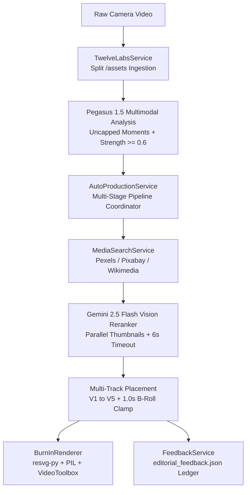

# ⚙️ Backend Architecture & Services Specification
**FastAPI • Services Layer • Data Flow • Third-Party AI Integrations**

This document provides a comprehensive technical breakdown of the **DaVinci Resolve Companion Backend** (`backend/app`).

---

## 1. Backend Application Lifecycle & Core Architecture

### 1.1 Entrypoint & Middleware (`backend/app/main.py`)
* **Framework**: FastAPI running under Uvicorn ASGI server on port `8002`.
* **CORS Policy**: Configured via `CORSMiddleware` with `allow_origins=["*"]`, `allow_credentials=True`, `allow_methods=["*"]`, `allow_headers=["*"]`.
* **Database Initialization**: On startup, `Base.metadata.create_all(bind=engine)` creates or migrates SQLite schema in `backend/resolve_companion.db`.
* **Static File Mounts**:
  * `/projects`: Mounts `backend/projects` for direct asset retrieval (thumbnails, proxies, exported MP4s).
* **Routers Registered**:
  * `/api/projects`: `app.api.projects.router` (Project management, cloning, trash deletion)
  * `/api/media`: `app.api.media.router` (Video upload streaming, proxies, Twelve Labs, search, rendering)
  * `/api/subtitles`: `app.api.subtitles.router` (Whisper transcription, formatting, reasoning log)
  * `/api/graphics`: `app.api.graphics.router` (Motion templates, track manipulation)
  * `/api/feedback`: `app.api.feedback.router` (Editor decision logging, training stats, few-shot export)
  * `/api/articles`: `app.api.articles.router` (Article extraction & summary cards)
  * `/api/davinci`: `app.api.davinci.router` (DaVinci Resolve IPC bridge & FCPXML export)

### 1.2 Configuration & System Dependencies (`backend/app/core/config.py`)
* **Pydantic Settings**: `Settings(BaseSettings)` reads configuration from environment and `.env`.
* **Critical Path Resolutions**:
  * `projects_dir`: `backend/projects`
  * `ffmpeg_bin`: Resolved dynamically via `shutil.which("ffmpeg")` or macOS standard paths (`/opt/homebrew/bin/ffmpeg`, `/usr/local/bin/ffmpeg`).
  * `ffprobe_bin`: Resolved dynamically via `shutil.which("ffprobe")`.
* **Active API Credentials**:
  * `TWELVE_LABS_API_KEY`: `"[configured in backend/.env — value omitted]"` (Marengo 3.0 & Pegasus 1.5)
  * `GEMINI_API_KEY`: `"[configured in backend/.env — value omitted]"` (Gemini 2.5 Flash Vision Reranker)
  * `PEXELS_API_KEY`: `"[configured in backend/.env — value omitted]"` (Pexels Stock Media API)
  * `PIXABAY_API_KEY`: `"[configured in backend/.env — value omitted]"` (Pixabay Stock Media API)

### 1.3 Database Models & Persistence (`backend/app/core/models.py`)
* **Project**:
  * `id`: Unique string ID (e.g. `proj_111sub_1789910026802`).
  * `name`, `status`, `source_media_path`, `duration_seconds`, `fps`, `aspect_ratio` (default `9:16`).
  * `created_at`, `updated_at`.
* **Caption**:
  * `id`, `project_id`, `start_time`, `end_time`, `text`, `translated_text`, `style_override` (JSON), `words` (word-level timestamps array).
* **Cue** (Visual Reasoning Beat):
  * `id`, `project_id`, `start_time`, `end_time`, `cue_type`, `suggested_action`, `confidence`, `reasoning`, `search_query`, `media_url`.
* **RenderJob**:
  * `id`, `project_id`, `status` (`queued`, `rendering`, `completed`, `failed`), `progress`, `output_path`, `error_message`.

---

## 2. Core Backend Services Deep Dive



---

### 2.1 TwelveLabsService (`backend/app/services/twelve_labs_service.py`)

Handles all video understanding, multimodal temporal indexing, and cloud generative reasoning.

#### 1. Split Ingestion Architecture (`/assets` + `/indexed-assets`)
* **Why Split Ingestion**: Legacy monolithic `/tasks` tightly coupled video upload with a specific index, causing index lock-in and requiring re-uploading large video files. The split flow separates asset upload from indexing.
* **Full-File SHA-256 Fingerprinting (`_get_file_hash`)**:
  ```python
  hasher = hashlib.sha256()
  with open(video_path, "rb") as f:
      while chunk := f.read(65536):
          hasher.update(chunk)
  return hasher.hexdigest()
  ```
  Guarantees 100% collision-free identification across all videos.
* **Direct Asset Upload (`upload_asset`)**:
  * If file exceeds 30MB, compresses a 720p hardware proxy using Apple Silicon VideoToolbox (`-c:v h264_videotoolbox -b:v 1200k`), reducing transfer time from minutes to seconds.
  * Dispatches `POST https://api.twelvelabs.io/v1.3/assets` with `method="direct"`.
  * Polls `GET /assets/{asset_id}` until `status == "ready"`.
  * Caches `file_hash -> { asset_id, filename, cached_at }` in `backend/projects/twelve_labs_assets.json`.
* **Indexed Asset Association (`index_asset`)**:
  * Dispatches `POST https://api.twelvelabs.io/v1.3/indexes/{index_id}/indexed-assets` with `{"asset_id": asset_id}`.
  * **HTTP 202 Accepted Support**: Natively handles HTTP 202 (Accepted for asynchronous indexing).
  * Polls `GET /indexes/{index_id}/indexed-assets/{indexed_asset_id}` every 5 seconds until `status == "ready"`.
  * If already indexed, Twelve Labs returns `409 Conflict` or existing record, which the service treats as ready immediately.

#### 2. Non-Streaming Blocking Pegasus 1.5 Reasoning (`get_pegasus_reasoning`)
* Dispatches standard blocking `POST https://api.twelvelabs.io/v1.3/analyze` with `"stream": false`.
* Eliminates Server-Sent Events (SSE) socket drops and partial JSON chunk assembly.
* **Prompt Schema & Chain-of-Thought Ordering**:
  * Forces model to generate `reasoning` **before** categorical decisions:
    ```json
    {
      "reasoning": "Speaker references the landmark trial; on-screen report proves credibility.",
      "start_sec": 14.5,
      "end_sec": 18.0,
      "graphic_type": "article_reconstruction",
      "title": "Lancet Study Findings",
      "search_query": "Lancet medical journal clinical trial results page",
      "strength": 0.95
    }
    ```
  * Continuous `strength` score ($0.0 - 1.0$).
  * Embeds exact word-level Whisper transcript blocks `[00:00.00s -> 00:00.50s] Word...` directly into prompt context.
  * Strictly requires concrete physical descriptors for `search_query` (prohibits vague concepts like "health" or "uncertainty").

#### 3. Quota & Credit Management Engine (`twelve_labs_usage.json`)
* Total allowance: **600.0 minutes** (10 hours free tier).
* Computes real-time usage: `max(local_tracked_seconds, remote_indexes_total_duration)`.
* Returns `consumed_minutes`, `remaining_minutes`, `one_minute_videos_left`, and days until expiry (`2026-12-20`).

---

### 2.2 MediaSearchService (`backend/app/services/media_search_service.py`)

Multi-provider stock media aggregator with vision reranking.

#### 1. Provider Aggregation
* Queries **Pexels**, **Pixabay**, and **Wikimedia Commons** concurrently.
* Filters out watermarked or low-resolution results.
* Normalizes candidate metadata into:
  * `id`, `provider`, `type` (`image` or `video`), `title`, `url`, `thumbnail_url`, `width`, `height`, `duration`.

#### 2. Gemini 2.5 Flash Multimodal Vision Reranker (`rerank_candidates_with_vision`)
* Rather than blindly trusting result #1, queries for the top 8–10 candidates.
* Concurrently downloads candidate image thumbnails into memory using `ThreadPoolExecutor` and `httpx`.
* Invokes `gemini-2.5-flash` with the Pegasus `visual_reasoning` context, target `search_query`, and candidate image parts.
* Prompts the model to return strict JSON:
  ```json
  {
    "selected_index": 2,
    "justification": "Candidate #2 shows an authentic clinical CT scan in high contrast, matching the medical trial context."
  }
  ```
* **6.0-Second Latency Guard**: If the vision call exceeds 6 seconds or fails, it automatically falls back to candidate #1 without blocking the pipeline.

---

### 2.3 ReferenceLibraryService (`backend/app/services/reference_library_service.py`)

The single source of truth for design styles, layout templates, and visual rules across the entire studio.

#### Unified Style Taxonomy
1. **Storyboard Generator Presets**:
   * `creator_red_ribbon`: Red Ribbon Banner + Mixed Serif/Italics, 1.2x host punch-in, bold impact typography.
   * `cutout_collage_radar`: 2.5D Collage Cutout + Concentric Radar Waves & Red Oval, muted sepia tones.
   * `doodle_underline`: Depth-of-Field Defocus + Red Marker Doodle Underline, playful educational accents.
   * `cutout_landscape`: Cutout Subject in Landscape + Tracking Ribbon, editorial magazine framing.
2. **Companion Studio Editorial Templates**:
   * `article_reconstruction`: Full-Screen Pure White Paper (`#FFFFFF`), authentic publisher SVG masthead, Georgia typography, physical kinetic highlighter sweep, research figure below text.
   * `split_screen_vertical`: 50/50 Broadcast Split Evidence (speaker camera left, evidence right; clean divider, zero badges or watermarks).
   * `dimension_callout`: Animated cyan metric HUD for physical units (`7 CM`, `12 MM`), high-tech targeting box.
   * `youtube_insert`: High-authority B-roll cutaway (clamped strictly to $\le 1.0$s).

---

### 2.4 AutoProductionService (`backend/app/services/auto_production_service.py`)

The primary zero-click orchestration engine that transforms a raw video into a fully edited timeline:

1. **Dialogue Transcription & Word Alignment**: Calls Whisper to produce word-level timestamps.
2. **Transcript Anchor Formatting**: Formats captions into timestamped anchor strings:
   `[00:12.34s -> 00:13.80s] Word ...`
3. **Twelve Labs Pegasus Reasoning**: Calls `TwelveLabsService.get_pegasus_reasoning` with the asset and transcript.
4. **Code-Level Strength Filtering**:
   ```python
   if strength < 0.6:
       logger.info(f"Skipping cue '{title}': strength {strength:.2f} < 0.6 threshold")
       continue
   ```
5. **Stock Sourcing & Vision Reranking**: Queries stock media for each cue and invokes Gemini 2.5 Flash to pick the best visual match using the cue's `visual_reasoning`.
6. **Track Allocation**:
   * Research Articles $\rightarrow$ Track **V4**
   * 50/50 Dual Vertical Splits & B-Roll Cutaways $\rightarrow$ Track **V3**
   * HUD Dimension Callouts $\rightarrow$ Track **V5** (Overlays)
7. **Strict Duration Clamping**:
   * For `split_screen_vertical` and `youtube_insert`: Clamped to strictly $\le 1.0$s:
     `end_s = round(min(end_s, start_s + 1.0), 2)`.
   * For `article_reconstruction`: Preserves multi-second reading time (e.g. 5.0s–7.0s).
8. **Visual Reasoning Log**: Appends every decision, strength score, reasoning justification, and stock rerank note into `visual_reasoning_log.json`.

---

### 2.5 FeedbackService (`backend/app/services/feedback_service.py`)

Manages the human-in-the-loop review system and few-shot training export.

#### 1. Persistent Audit Ledger (`backend/projects/editorial_feedback.json`)
Stores all editor review actions:
* `decision_id`: Unique UUID (`fbc_<uuid>`).
* `project_id`: Source video project ID.
* `decision`: `'keep' | 'cut' | 'swap'`
* `timestamp`: ISO-8601 string.
* `start_sec`, `end_sec`: Timeline boundaries.
* `original_graphic_type`, `original_search_query`: AI suggestions.
* `strength`: Model strength rating.
* `reasoning`: AI natural language justification.
* `transcript_excerpt`: Spoken words at cue moment.
* `modified_graphic_type`, `modified_search_query`: Editor overrides (for `swap`).
* `editor_notes`: Optional editor feedback.

#### 2. Real-Time Aggregate Statistics
Computes totals, rates, and formats the user-specified summary string:
* `summary_text`: `"124 decisions → 71 kept | 31 cut | 22 modified"`
* `keep_rate`, `cut_rate`, `swap_rate`: Percentages rounded to 1 decimal place.

#### 3. Few-Shot Prompt Exporter
Generates Markdown few-shot training blocks pairing kept moments with high praise and cut moments with clear negative rules for manual prompt iteration.
> [!IMPORTANT]
> **Strict Manual Curation**: Logged decisions are **never** automatically injected into the live Pegasus production prompt without manual engineering review.

---

### 2.6 BurnInRenderer (`backend/app/services/burnin_renderer.py`)

Headless compositing and hardware-accelerated video rendering engine:

* **Hardware Acceleration**: Uses Apple Silicon VideoToolbox (`-c:v h264_videotoolbox -b:v 8000k`) with software fallback (`libx264 -crf 18`).
* **Vector SVG Rasterization (`resvg-py`)**:
  * Standard PIL `Image.open()` fails on SVG files.
  * Integrates `resvg-py` to rasterize SVGs directly into memory with automatic contrast correction (replaces white text `#FFF` with dark slate `#0F172A` when placed on white paper).
* **Typography**:
  * Headline: Georgia Bold (`/System/Library/Fonts/Supplemental/Georgia Bold.ttf`).
  * Body: Georgia Regular (`/System/Library/Fonts/Supplemental/Georgia.ttf`).
* **Kinetic Highlighter Math**:
  * Sweep progress: `progress = min(1.0, max(0.0, (elapsed - 0.2) / max(0.6, duration * 0.6)))`.
  * Highlight blocks drawn with rounded rectangle corners (`radius=6`) behind the text before words are stamped on top.
* **Subtitle Styling Toggle Parity**:
  * When `has_active_word_highlight` and `has_keyword_emphasis` are both toggled OFF, subtitles render in uniform crisp white (`#FFFFFF`) with zero overrides, matching the viewer identically.

---

### 2.7 DaVinciBridge (`backend/app/services/davinci_bridge.py`)

Bidirectional synchronization with DaVinci Resolve Studio:
* Communicates via DaVinci Resolve’s `fusionscript` IPC socket.
* Generates **Final Cut Pro XML (FCPXML 1.8)** files mapping tracks V1–V5 and audio directly into a new DaVinci timeline.
* Automatically creates Fusion compound clips for complex animations.
