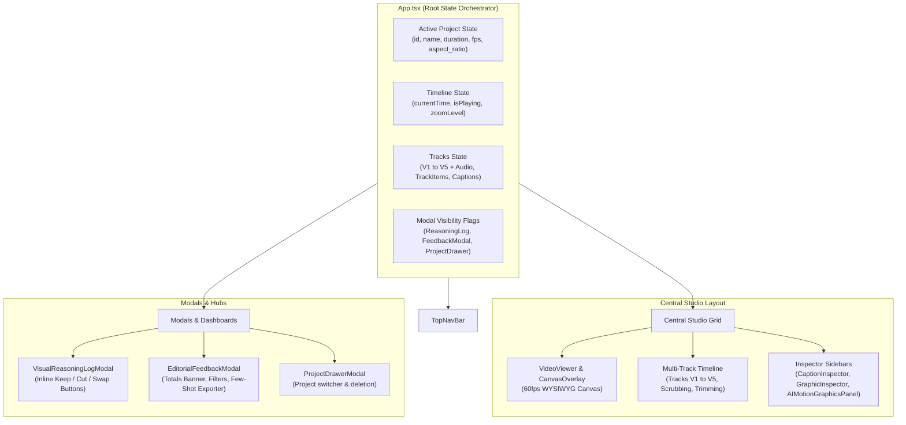

# 🎨 Frontend Architecture & Components Specification
**React 18 • TypeScript • Vite • 60fps Canvas Viewer • Multi-Track Timeline**

This document details the frontend architecture, component tree, state management, and rendering pipelines of the **DaVinci Resolve Companion Frontend** (`frontend/src`).

---

## 1. Frontend Architecture & Technology Stack

* **Framework**: React 18 with TypeScript.
* **Bundler & Dev Server**: Vite (running on port `5174`).
* **Styling**: Tailwind CSS with custom editorial design tokens.
* **Icons**: `lucide-react`.
* **Rendering Paradigm**: Hybrid HTML5 `<video>` for raw playback + HTML5 `<canvas>` for 60fps animated overlays, bounding box transforms, and pixel-accurate graphics.

---

## 2. Global State Management (`frontend/src/App.tsx`)

The root `App.tsx` component orchestrates all application state and synchronizes with the backend REST API:

### 2.1 Core State Variables
* `project: Project | null`: Currently active project record.
* `currentTime: number`: Global playback playhead time (seconds). Synchronized across VideoViewer, Timeline, and CanvasOverlay.
* `isPlaying: boolean`: Global playback state.
* `captions: Caption[]`: Word-level subtitle segments with styling parameters.
* `tracks: TimelineTrack[]`: Multi-track timeline model holding clips across V1–V5 and A1.
* `selectedItem: TrackItem | Caption | null`: Currently selected item displayed in the active Inspector panel.
* `twelveLabsCredits: TwelveLabsCredits | null`: Live usage quota and remaining minutes.
* `feedbackStats: FeedbackStats | null`: Real-time feedback totals (`kept`, `cut`, `swapped`, `summary_text`).

### 2.2 Native XHR Streaming Video Upload (`handleUploadVideo`)
* **0 RAM Overhead**: Uses native `XMLHttpRequest` streaming chunks directly from disk instead of `file.arrayBuffer()` which previously allocated 800MB+ in browser memory.
* **Live Progress**: Reports real-time upload progress (`Uploading video (45%)...`).
* **Filename Encoding**: Uses `encodeURIComponent(file.name)` in request headers to safely support Hindi, emojis, or spaces in filenames.
* **State Preservation**: Safely updates `project.id` without clearing existing tracks or resetting timeline handles.

---

## 3. Visual Components Deep Dive

### 3.1 Top Navigation Bar (`frontend/src/components/layout/TopNavBar.tsx`)

* **Project Switcher**: Dropdown displaying all available local projects with one-click switching.
* **Native Video Upload Button**: Live upload progress indicator and progress bar.
* **Aspect Ratio Indicator**: Displays active video ratio (`9:16` vertical mobile vs `16:9` landscape).
* **Save Status Pill**: Real-time indicator (`Saved`, `Saving...`, `Unsaved changes`).
* **Twelve Labs Credit Widget**:
  * Displays remaining minutes (e.g. `576m left / 600m`), expiry date (`Dec 20, 2026`), and percentage used.
  * Dropdown includes API key input, quota diagnostics, and an **"Analyze Video with 12Labs"** trigger button.
* **Feedback Counter Badge**:
  * Purple pill button showing live count of logged editor decisions (e.g. `Feedback 124`).
  * Clicking opens the **Editorial Feedback Dashboard**.
* **DaVinci Resolve Sync Button**: Initiates one-click FCPXML export or direct Python IPC bridge synchronization.

---

### 3.2 Central Live Viewer (`VideoViewer.tsx` + `CanvasOverlay.tsx`)

Provides true **100% WYSIWYG parity** between what is previewed in the browser and what is exported to MP4.

#### 1. VideoViewer (`VideoViewer.tsx`)
* HTML5 `<video>` element with hardware GPU acceleration.
* **Frame-Accurate Synchronization**:
  * Hooks `onTimeUpdate`, `onSeeked`, `onLoadedMetadata`, and `onCanPlay`.
  * Synchronously seeks the video element when the timeline playhead scrubs, eliminating desynchronization.
  * Uses `preload="auto"` to cache adjacent frames for stutter-free scrubbing.

#### 2. CanvasOverlay (`CanvasOverlay.tsx`)
* An interactive 2D canvas rendered directly over the video player at 60fps:
  * **50/50 Dual Vertical Split Screen**: Renders the split divider line and documentary evidence clip on the right side while the host plays on the left.
  * **Investigative Research Article**: Renders the pure white full-screen paper document with the official SVG logo, Georgia typography, physical kinetic highlighter marker sweep, and research figures placed below the text.
  * **Interactive Bounding Box Controls**: Selected clips display drag-and-drop bounding boxes with corner handles for interactive scaling, rotation, and repositioning.
  * **Karaoke Subtitle Box**: Renders rounded pill background boxes with word-level active highlighting and keyword accent colors.

---

### 3.3 Multi-Track Timeline (`frontend/src/components/timeline/Timeline.tsx`)

A non-linear, multi-track timeline built for high-speed editorial workflows:

| Track | Role | Content Type |
| :--- | :--- | :--- |
| **V5 (Top)** | HUD & Dimension Callouts | Animated cyan targeting boxes, measurement units (`7 CM`). |
| **V4** | Investigative Research Articles | Full-screen pure white paper reports with kinetic highlighter wipes. |
| **V3** | Split Screens & B-Roll Cutaways | 50/50 dual vertical splits and 1.0s B-roll video inserts. |
| **V2** | Host Speaker Reframing | 9:16 vertical crop of the primary host. |
| **V1 (Bottom)** | Source Camera Video | Primary untrimmed master camera video. |
| **A1** | Audio Waveform | 16kHz speech audio waveform with volume envelope. |
| **Subtitles** | Caption Track | Word-timed subtitle blocks with active karaoke highlights. |

#### Interactive Timeline Features
* **Playhead Scrubbing**: Click or drag the timeline ruler to seek to any millisecond.
* **Clip Handles & Trimming**: Drag the left or right edges of any clip to trim in/out points.
* **Clip Snapping**: Automatic magnetic snapping to subtitle boundaries and adjacent clip cuts.
* **Track Solo & Mute**: Toggle track visibility or audio monitoring.
* **Zoom Slider**: Scale from bird's-eye view (entire 90s video) down to single-frame resolution.

---

### 3.4 Inspector Panels (`frontend/src/components/inspector/`)

#### 1. CaptionInspector (`CaptionInspector.tsx`)
* **Typography Controls**: Font family selection (Inter, Georgia, Bebas Neue, Montserrat), font size, weight, letter spacing.
* **Line Formatting**: One-click toggles between **1-line** and **2-line** subtitle layouts.
* **Karaoke & Highlight Toggles**:
  * `has_highlight`: Toggles active spoken word color override (e.g. Neon Yellow `#FFFF00` or Lime `#CCFF00`).
  * `has_keyword_emphasis`: Toggles colored keyword accenting (e.g. Cyan `#00F0FF` for medical metrics).
  * *When both toggles are turned OFF, subtitles render in uniform crisp white (`#FFFFFF`) with zero overrides.*

#### 2. GraphicInspector (`GraphicInspector.tsx`)
* Controls properties for the selected visual clip on tracks V3, V4, or V5:
  * Scale ($0.1\times - 3.0\times$) and 2D Position ($X, Y$).
  * CRT Scanlines overlay toggle.
  * Source citation footer text.
  * Start and End timestamp inputs.

#### 3. AIMotionGraphicsPanel (`AIMotionGraphicsPanel.tsx`)
* Contains the **18 Pre-Made Template Library** (Creator Red Ribbon, Radar HUD, Cutout Landscape, Article Reconstruction, etc.).
* Custom text prompt input to generate new procedural motion graphics on demand.

---

### 3.5 Modals & Hubs (`frontend/src/components/modals/`)

#### 1. VisualReasoningLogModal (`VisualReasoningLogModal.tsx`)
* Displays an audit trail of Twelve Labs Pegasus 1.5 reasoning decisions.
* **Inline Editor Actions on Every Card**:
  * 🟢 **Keep**: Approves the visual cue.
  * 🔴 **Cut**: Discards the cue.
  * 🟡 **Swap**: Opens a modal to change graphic type or edit the search query.
* Header includes a button to open the **Editorial Feedback & Training Dashboard**.

#### 2. EditorialFeedbackModal (`EditorialFeedbackModal.tsx`)
The central review hub and training data exporter:
* **Live Summary Banner**:
  Displays aggregate counts formatted as:
  $$\text{124 decisions} \rightarrow \text{71 kept} \mid \text{31 cut} \mid \text{22 modified}$$
* **Interactive Multi-Filter Bar**:
  * Filter by Decision: `All`, `Kept (🟢)`, `Cut (🔴)`, `Modified (🟡)`.
  * Filter by Graphic Type: `split_screen_vertical`, `article_reconstruction`, `dimension_callout`, `youtube_insert`.
  * Filter by Project: Select source project.
  * **Min Strength Slider**: Interactive slider ($0.0 - 1.0$) filtering decisions by model confidence score.
* **Decision Cards**: Displays timestamps, visual type badges, strength meters, transcript excerpts, AI reasoning, and modification diffs.
* **Few-Shot Exporter Tab**:
  * Formats curated decisions into clean Markdown few-shot training blocks.
  * Includes a **"Copy Few-Shot Prompt"** button for 1-click clipboard copying.

---

## 4. Client API Layer (`frontend/src/services/api.ts`)

A strongly-typed API client handling all communication with the FastAPI backend:
* `getProjects()`, `getProject(id)`, `deleteProject(id)`
* `uploadVideo(file, projectId, onProgress)`
* `autoProduce(projectId)`
* `getTwelveLabsCredits()`, `setTwelveLabsKey(key)`, `analyzeWithTwelveLabs(projectId)`
* `searchMedia(query, type, provider, projectId)`
* `logDecision(decisionPayload)`, `getFeedbackDecisions(filters)`, `getFeedbackStats()`, `getFewShotExport()`
* `renderVideo(projectId, burnSubtitles, quality)`
