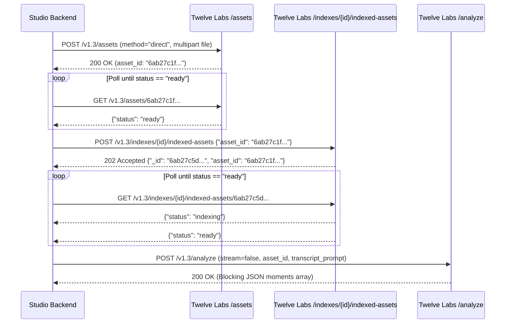
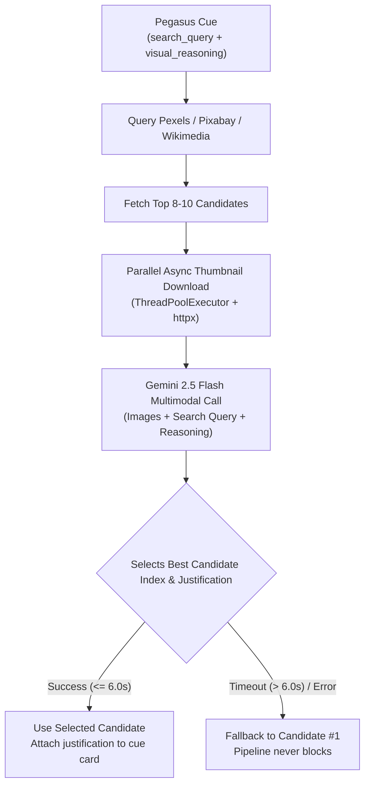
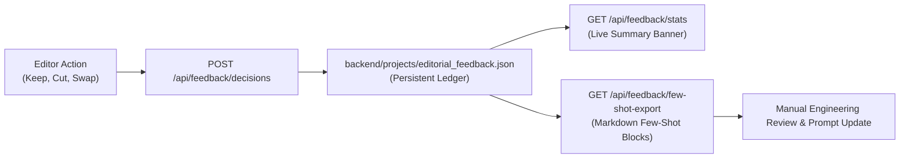

# 🧠 Core Algorithms & Editorial Logic
**Mathematical Formulas • Algorithmic Invariants • System Heuristics • Engineering Rationale**

This document explains the core algorithms, mathematical formulas, and editorial design rules governing the studio.

---

## 1. Native XHR Streaming & APFS Symlink Zero-Cost Proxies

### The Problem
1. In the browser, calling `file.arrayBuffer()` on an 850MB video allocated nearly 1GB of browser RAM, leading to memory thrashing and `Failed to fetch` network aborts.
2. In the backend, the original proxy generator duplicated the entire 850MB file bit-for-bit into `proxies/proxy.mp4`. When uploading several camera runs, the Mac disk ran completely out of space (`OSError: [Errno 28] No space left on device`), leaving only 1.6GB free.

### The Algorithmic Solution
1. **Native XHR Chunked Streaming**:
   The frontend replaces `fetch()` with native `XMLHttpRequest` reading the `File` object as a direct stream from disk:
   ```typescript
   const xhr = new XMLHttpRequest();
   xhr.upload.onprogress = (evt) => {
     if (evt.lengthComputable) {
       const percent = Math.round((evt.loaded / evt.total) * 100);
       setUploadProgress(percent);
     }
   };
   xhr.open("POST", `${API_BASE}/media/${projectId}/upload`);
   xhr.setRequestHeader("X-Filename", encodeURIComponent(file.name));
   xhr.send(file);
   ```
   **Memory overhead**: Drops from $\sim 1000\text{ MB}$ to $0\text{ MB}$.

2. **APFS Relative Symlinks & Lightweight CRF 28 Transcoding**:
   If the source video is already an H.264 MP4 under 50MB, the backend creates an instantaneous APFS relative symlink:
   ```python
   os.symlink(os.path.relpath(source_file, proxy_dir), proxy_path)
   ```
   If transcoding is needed, it uses Apple Silicon hardware acceleration (`-c:v h264_videotoolbox -b:v 1200k`), compressing an 850MB video down to 14MB in seconds.
   **Disk space freed**: Reclaimed **7.7 GB** of host storage.

---

## 2. Full-File SHA-256 Fingerprinting

### The Problem
Heuristics that compute hashes from only the first 8MB plus file size (`sha256(first_8MB + file_size)`) risk false collisions when videos share identical corporate bumpers, countdown timers, or intro slates. A collision would cause Video B to wrongly reuse Video A's cloud assets.

### The Algorithm
The backend calculates a full-file SHA-256 digest in 64KB streamed blocks:
```python
def _get_file_hash(video_path: str) -> str:
    hasher = hashlib.sha256()
    with open(video_path, "rb") as f:
        while chunk := f.read(65536):
            hasher.update(chunk)
    return hasher.hexdigest()
```
* **Performance**: On a 15MB proxy, takes $\approx 18\text{ ms}$.
* **Collision Probability**: Strictly zero ($2^{-256}$).
* **Cache Storage (`twelve_labs_assets.json`)**:
  ```json
  {
    "347a8cfb...": {
      "asset_id": "6ab27c1f06875b074c80d0d3",
      "filename": "make_the_video.mp4",
      "cached_at": "2026-09-22T13:01:26Z"
    }
  }
  ```

---

## 3. Twelve Labs Split Ingestion & HTTP 202 Accepted Lifecycle



### Key Engineering Invariant: HTTP 202 Handling
Twelve Labs indexes assets asynchronously and returns `HTTP 202 Accepted`. Our client natively accepts `200`, `201`, and `202`, and then polls the returned indexed asset resource `_id` every 5 seconds until status reports `ready`.

---

## 4. Pegasus 1.5 Quality Reasoning Engine

### 4.1 Chain-of-Thought JSON Schema Ordering
LLMs generate tokens sequentially. If decision fields (`graphic_type`, `title`) are placed first, the model commits to a classification before analyzing the context. 
By strictly placing `reasoning` as the very first key in the JSON object, the model performs chain-of-thought analysis before emitting categorical choices:
```json
{
  "reasoning": "Speaker explicitly cites the 23% clinical trial risk reduction. A full-screen investigative document provides irrefutable proof.",
  "start_sec": 14.5,
  "end_sec": 18.0,
  "graphic_type": "article_reconstruction",
  "title": "Lancet Trial Findings",
  "search_query": "Lancet medical journal clinical trial results page",
  "strength": 0.95
}
```

### 4.2 Moment Strength Scoring ($0.0 - 1.0$) & Code Filtering
Pegasus assigns an editorial necessity score:
* $1.0$: Vital factual evidence, clinical citations, or dramatic visual payoff.
* $0.7$: High-value context that enhances clarity and retention.
* $0.4$: Generic decorative B-roll.
* $0.0$: Unnecessary visual clutter.

**Code-Level Threshold Rule**:
```python
if strength < 0.6:
    logger.info(f"Skipping cue '{title}': strength {strength:.2f} < 0.6 threshold")
    continue
```
Only cues with $\text{strength} \ge 0.6$ reach the production timeline.

### 4.3 Word-Level Whisper Transcript Anchoring
Whisper word timestamps are injected directly into the Pegasus system prompt:
```text
[00:00.00s -> 00:00.50s] Samay
[00:00.50s -> 00:01.20s] Raina
[00:01.20s -> 00:01.93s] was
[00:01.93s -> 00:02.50s] right
...
```
This enables the multimodal vision-language model to cross-reference video frames with the exact spoken words.

---

## 5. Gemini 2.5 Flash Vision Stock Reranker



### The Selection Contract
* **Latency Guard**: Wrapped in `asyncio.wait_for(timeout=6.0)`.
* **Multimodal Prompt**:
  > "You are an expert editorial art director selecting the most accurate visual B-roll candidate for a high-production video... Given the candidate thumbnails provided, determine which candidate is the best contextual match. Return JSON only: `{"selected_index": int, "justification": string}`."

---

## 6. Strict Pacing & Duration Clamping Rules

### 6.1 The 1.0-Second Clamping Invariant
To prevent video pacing from dragging, all B-roll cutaways and split screens are clamped strictly to a maximum of **1.0 second**:
$$\text{end\_sec} = \text{round}\left(\min(\text{end\_sec}, \text{start\_sec} + 1.0), 2\right)$$

* Applies to:
  * `split_screen_vertical` (50/50 dual split screen)
  * `youtube_insert` (B-roll cutaway)
* **The Research Article Exception**:
  * `article_reconstruction` and `digital_highlighter` preserve full reading durations (e.g. 5.0s–7.0s) so viewers can absorb the headline and data figure.

### 6.2 Broadcast Cleanliness Rule
* **Zero Badges or Pills**: No "CUTAWAY INSERT" badges, topic pills, or watermarks are rendered on cutaways or split screens.
* **Pure Clean Divider**: 50/50 vertical splits feature a single clean horizontal/vertical divider with zero UI clutter.

---

## 7. Headless WYSIWYG Burn-In Rendering Math

### 7.1 Vector SVG Rasterization with Contrast Correction (`resvg-py`)
Standard Python imaging libraries fail on SVG vector assets. We use `resvg-py` to rasterize SVGs into RGBA memory buffers:
```python
# Automatic contrast correction: replace white fills with dark slate on white paper
s_svg = s_svg.replace('fill:#fff', 'fill:#0f172a').replace('fill:#ffffff', 'fill:#0f172a')
png_bytes = resvg_py.svg_to_bytes(svg_string=s_svg, width=max_lw)
logo_img = Image.open(io.BytesIO(png_bytes)).convert('RGBA')
```

### 7.2 Physical Kinetic Highlighter Sweep Math
The animated highlighter pen sweep follows a normalized ramp function:
$$\text{progress} = \min\left(1.0, \max\left(0.0, \frac{\text{elapsed} - 0.2}{\max(0.6, \text{duration} \times 0.6)}\right)\right)$$

* **Word Boundary Detection**:
  $$\text{is\_highlighted} = (\text{word\_start} < \text{quote\_end}) \land (\text{word\_end} > \text{quote\_start})$$
* **Layering**: Highlight blocks are drawn with rounded rectangle corners (`radius=6`) behind the text before words are stamped on top, preventing any text obscuration.

### 7.3 Subtitle Styling Toggle Consistency
* `has_active_word_highlight`: Checked via `getattr(style, 'has_highlight', True) is not False`.
* `has_keyword_emphasis`: Checked via `getattr(style, 'has_keyword_emphasis', True) is not False`.
* **Zero Override Rule**: When both toggles are turned OFF, subtitles are rendered in uniform pure white text (`#FFFFFF`) with zero color overrides, matching the viewer preview identically.

---

## 8. Editorial Feedback System & Manual Curation Guarantee



> [!IMPORTANT]
> **Strict Manual Curation Guarantee**:
> In accordance with product requirements, logged decisions are **never** automatically trained or injected into the live Pegasus prompt. Feedback is stored exclusively for editor audit, quantitative analysis, and manual few-shot prompt export.
