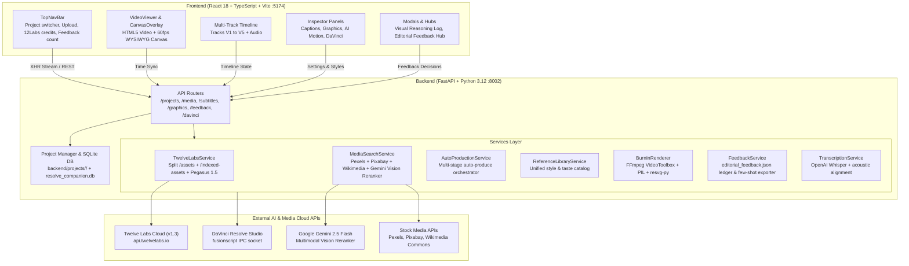

# 🚀 DaVinci Resolve AI Editing Companion — Developer Onboarding Master Guide
**Engineering Handbook • Architecture Specifications • API Reference • Editorial Algorithms**

Welcome to the team! This directory contains the complete technical onboarding documentation for the **DaVinci Resolve AI Editing Companion** (`davinci-companion`).

Whether you are working on the FastAPI backend, the React/TypeScript frontend, the Twelve Labs multimodal reasoning engines, or DaVinci Resolve Fusion automation, these documents cover every system, file, API, and algorithm in production.

---

## 📚 Documentation Index & Reading Order

For incoming engineers, follow this reading order to build full system mastery:

| Doc | File | Description |
| :--- | :--- | :--- |
| **01** | [**01_BACKEND_ARCHITECTURE_AND_SERVICES.md**](./01_BACKEND_ARCHITECTURE_AND_SERVICES.md) | Deep dive into FastAPI backend, services layer, database schema, and third-party integrations. |
| **02** | [**02_FRONTEND_ARCHITECTURE_AND_COMPONENTS.md**](./02_FRONTEND_ARCHITECTURE_AND_COMPONENTS.md) | React 18 component hierarchy, 60fps canvas viewer, multi-track timeline, inspectors, and modal dashboards. |
| **03** | [**03_API_REFERENCE_AND_PAYLOADS.md**](./03_API_REFERENCE_AND_PAYLOADS.md) | Complete REST API dictionary with endpoints, request/response JSON schemas, and error definitions. |
| **04** | [**04_CORE_ALGORITHMS_AND_EDITORIAL_LOGIC.md**](./04_CORE_ALGORITHMS_AND_EDITORIAL_LOGIC.md) | Core logic: Twelve Labs split ingestion, Pegasus prompt reasoning, Gemini vision reranking, 1.0s clamping, and burn-in math. |
| **05** | [**05_SETUP_RUNBOOK_AND_TROUBLESHOOTING.md**](./05_SETUP_RUNBOOK_AND_TROUBLESHOOTING.md) | Local environment setup, dependency management, server startup, and debugging runbooks. |

---

## 🌟 What is the DaVinci AI Editing Companion?

The studio is a **hybrid local-and-cloud video editing workstation and AI co-pilot** designed for documentary creators, educators, and clinical/technical editors. It automates post-production tasks that traditionally take hours in DaVinci Resolve or After Effects:

1. **Dialogue Transcription & Millisecond Word Timing**: Whisper AI generates word-by-word timestamps, active subtitle karaoke highlights, and keyword accenting.
2. **Multimodal Video Reasoning (Twelve Labs)**:
   * **Marengo 3.0**: Multimodal video & audio embedding and temporal semantic indexing.
   * **Pegasus 1.5**: Generative video reasoning that analyzes speech and visual frames to discover high-impact editorial moments (cues).
3. **Vision-Powered Stock Media Reranking (Gemini 2.5 Flash)**: Queries Pexels, Pixabay, and Wikimedia for the top 8–10 candidates, then uses Gemini 2.5 Flash to visually inspect thumbnails against Twelve Labs reasoning to pick the best contextual match.
4. **Broadcast Editorial Graphics**:
   * **50/50 Dual Vertical Splits**: Left side talking-head host, right side documentary evidence (zero badges/watermarks).
   * **Investigative Research Article Reconstructions**: Pure white full-page document clipping, official SVG publisher masthead, Georgia typography, physical kinetic highlighter sweep, and research figures placed directly under text.
   * **Dimension HUD Callouts**: Animated cyan targeting box for physical measurements (`7 CM`, `12 MM`).
   * **Contextual B-Roll Inserts**: High-authority cutaways strictly clamped to $\le 1.0$s.
5. **Pixel-Perfect WYSIWYG Burn-in Rendering**: Python/FFmpeg headless renderer using `resvg-py` for vector SVG rasterization and PIL for sub-pixel text rendering matching the browser canvas identically.
6. **Editor Feedback Logging & Few-Shot Exporter**: Captures human decisions (`Keep`, `Cut`, `Swap`) with context, reasoning, and diffs in `editorial_feedback.json` for few-shot prompt refinement (strict manual curation; zero automatic prompt pollution).
7. **DaVinci Resolve Native IPC Bridge**: Generates Apple FCPXML 1.8 timelines and Python Fusion scripting commands to sync cuts directly into DaVinci Resolve Studio.

---

## 🏛️ High-Level System Architecture



---

## 📁 Repository Directory Layout

```text
davinci-companion/
├── start_companion.sh                    # One-touch launch script for backend & frontend
├── docs/                                 # Complete developer onboarding handbook
│   ├── README.md                         # This master guide
│   ├── 01_BACKEND_ARCHITECTURE_AND_SERVICES.md
│   ├── 02_FRONTEND_ARCHITECTURE_AND_COMPONENTS.md
│   ├── 03_API_REFERENCE_AND_PAYLOADS.md
│   ├── 04_CORE_ALGORITHMS_AND_EDITORIAL_LOGIC.md
│   └── 05_SETUP_RUNBOOK_AND_TROUBLESHOOTING.md
├── backend/
│   ├── .env                              # API keys (Twelve Labs, Gemini, Pexels, Pixabay)
│   ├── app/
│   │   ├── main.py                       # FastAPI application entrypoint & CORS
│   │   ├── core/
│   │   │   ├── config.py                 # Pydantic BaseSettings, binary paths
│   │   │   ├── database.py               # SQLAlchemy SQLite engine & sessionmaker
│   │   │   └── models.py                 # ORM models (Project, Caption, Cue, RenderJob)
│   │   ├── api/
│   │   │   ├── projects.py               # CRUD operations on projects, trash deletion
│   │   │   ├── media.py                  # Video upload, proxies, thumbnails, waveform, 12Labs
│   │   │   ├── subtitles.py              # Whisper transcribe, word timing, reasoning log
│   │   │   ├── graphics.py               # Motion templates, track manipulation
│   │   │   ├── feedback.py               # Editor decision logging & few-shot exporter
│   │   │   ├── articles.py               # Article extraction & summary cards
│   │   │   └── davinci.py                # Resolve Python IPC bridge & FCPXML export
│   │   └── services/
│   │       ├── twelve_labs_service.py    # Marengo 3.0, Pegasus 1.5, Split /assets flow
│   │       ├── media_search_service.py   # Multi-provider stock search & Gemini vision reranker
│   │       ├── auto_production_service.py# Multi-stage auto production pipeline
│   │       ├── reference_library_service.py # Single source of truth for taste & style presets
│   │       ├── burnin_renderer.py        # FFmpeg VideoToolbox hardware burn-in engine
│   │       ├── feedback_service.py       # Editorial feedback ledger & stats calculator
│   │       ├── transcription_service.py  # Whisper speech recognition & acoustic alignment
│   │       ├── translation_service.py    # Hindi/Hinglish to English translation
│   │       ├── davinci_bridge.py         # DaVinci Resolve Python bridge
│   │       ├── fusion_templates.py       # DaVinci Fusion .setting macro generators
│   │       └── media_providers/
│   │           ├── pexels.py             # Pexels REST API client
│   │           ├── pixabay.py            # Pixabay REST API client
│   │           ├── wikimedia.py          # Wikimedia Commons API client
│   │           └── google_ai.py          # Google AI + procedural PIL graphics fallback
│   └── projects/                         # Active video project directories
│       ├── twelve_labs_assets.json       # SHA-256 -> asset_id cache
│       ├── twelve_labs_usage.json        # 600-minute free quota tracking
│       ├── editorial_feedback.json       # Editorial decision audit ledger
│       └── <project_id>/                 # Per-project assets, audio, captions, exports
└── frontend/
    ├── package.json
    ├── vite.config.ts                    # Vite bundler configuration (port 5174)
    ├── tailwind.config.js                # Tailwind CSS design system
    └── src/
        ├── App.tsx                       # Root layout & state orchestrator
        ├── types/index.ts                # TypeScript domain models & interfaces
        ├── services/api.ts               # Strongly-typed HTTP client
        └── components/
            ├── layout/
            │   └── TopNavBar.tsx         # App header, project selector, 12Labs & feedback badges
            ├── viewer/
            │   ├── VideoViewer.tsx       # Video element, HTML5 playback, time sync
            │   └── CanvasOverlay.tsx     # 60fps canvas overlay for 50/50 splits & bounding boxes
            ├── timeline/
            │   └── Timeline.tsx          # Multi-track timeline (V1–V5 + Audio)
            ├── inspector/
            │   ├── CaptionInspector.tsx  # Subtitle typography & styling panel
            │   ├── GraphicInspector.tsx  # Graphic track parameters, scale/position, CRT
            │   ├── AIMotionGraphicsPanel.tsx # 18 template catalog & generation
            │   └── DaVinciPanel.tsx      # DaVinci sync controls & FCPXML export
            └── modals/
                ├── VisualReasoningLogModal.tsx # Transparent AI decision reasoning log
                ├── EditorialFeedbackModal.tsx  # Editor review dashboard & few-shot exporter
                └── ProjectDrawerModal.tsx      # Project management drawer
```

---

## 🔑 Environment Variables & Active API Keys

The backend reads configuration directly from `backend/.env`. Below are the active production credentials:

```env
# Stock Media API Keys
PEXELS_API_KEY="[configured in backend/.env — value omitted]"
PIXABAY_API_KEY="[configured in backend/.env — value omitted]"

# Google Gemini API Key (Gemini 2.5 Flash Vision Reranker)
GEMINI_API_KEY="[configured in backend/.env — value omitted]"

# Twelve Labs API Key (Marengo 3.0 & Pegasus 1.5)
TWELVE_LABS_API_KEY="[configured in backend/.env — value omitted]"
```

---

## ⚡ Quickstart Cheat Sheet

### 1. Backend Server
```bash
cd /Users/sushil/.gemini/antigravity/scratch/davinci-companion/backend
python3 -m uvicorn app.main:app --host 0.0.0.0 --port 8002 --reload
```
* Runs on: `http://localhost:8002`
* OpenAPI Swagger UI: `http://localhost:8002/docs`

### 2. Frontend Development Server
```bash
cd /Users/sushil/.gemini/antigravity/scratch/davinci-companion/frontend
npm run dev
```
* Runs on: `http://localhost:5174`

---

*Proceed to [**01_BACKEND_ARCHITECTURE_AND_SERVICES.md**](./01_BACKEND_ARCHITECTURE_AND_SERVICES.md) for the complete backend architectural specification.*
